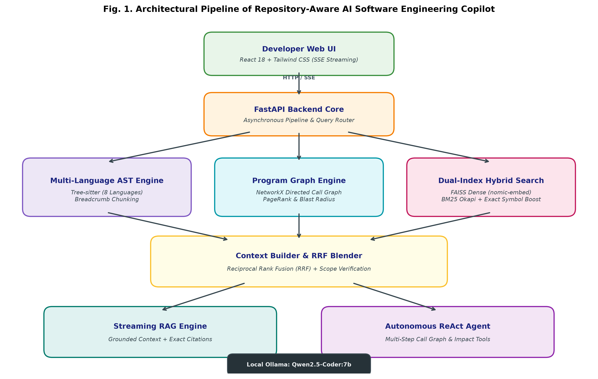

# AI Software Engineering Copilot for Large Codebases

[](https://www.python.org/downloads/)
[](https://fastapi.tiangolo.com)
[](https://tree-sitter.github.io/)
[](https://github.com/facebookresearch/faiss)
[](https://ollama.ai)

An enterprise-grade, **Repository-Aware RAG Intelligent Developer Assistant** that understands entire software repositories using multi-language Abstract Syntax Tree (AST) parsing, call and dependency graph analysis, context-enriched breadcrumb chunking, hybrid code retrieval, and local LLM reasoning.

---

## 🌟 Key Features

1. **Multi-Language AST Analysis (Tree-sitter)**
   - Extracts classes, methods, functions, docstrings, type annotations, decorators, line ranges, imports, and cross-function calls.
   - Built-in support for Python, TypeScript, JavaScript, Java, C++, C, Go, and Rust.

2. **Context-Enriched Breadcrumb Chunking**
   - Eliminates out-of-context code snippets by attaching hierarchical scope headers (`# File: ... # Class Scope: ... # Decorators: ... # Imports: ...`) to every chunk before embedding.

3. **Hybrid Code Retrieval & Reciprocal Rank Fusion (RRF)**
   - **Dense Semantic Retrieval:** FAISS vector similarity search using `nomic-embed-text`.
   - **Lexical Keyword Retrieval:** Custom BM25 Okapi code search engine with camelCase and snake_case identifier tokenization.
   - **Exact Symbol Boost:** Automatically matches query symbols to exact AST entity definitions.
   - **RRF:** Blends dense, sparse, and symbol results into a unified, high-precision rank list.

4. **Program Graph & Change Impact Analysis**
   - **Dependency Graph:** NetworkX-powered file import graph detecting circular dependencies and calculating PageRank architecture hubs.
   - **Call Graph:** Inter-function caller/callee resolution.
   - **Blast Radius Impact Analysis:** Predicts affected downstream modules, callers, risk level (LOW $\rightarrow$ CRITICAL), and recommends test cases before making changes.

5. **Dual Reasoning Engines**
   - **Repository-Grounded RAG:** High-speed streaming RAG grounded strictly in retrieved repository code with exact citations (`file:start-end`).
   - **Autonomous ReAct Agent:** Multi-step autonomous agent that executes tools (`search_code`, `get_symbol_callers`, `get_dependencies`, `read_file`, `get_impact`) to solve complex architectural questions.

6. **Modern Dark-Mode Web Interface**
   - Single-page application with real-time SSE token streaming, syntax-highlighted code snippets, hybrid search explorer, dependency viewer, impact calculator, and repository manager.

---

## 🏗️ Architecture



```
                       ┌──────────────────────┐
                       │      Developer       │
                       └──────────┬───────────┘
                                  │
                                  ▼
                       ┌──────────────────────┐
                       │  Web UI / CLI / API  │
                       └──────────┬───────────┘
                                  │
                                  ▼
                       ┌──────────────────────┐
                       │     FastAPI Core     │
                       └──────────┬───────────┘
                                  │
          ┌───────────────────────┼───────────────────────┐
          ▼                       ▼                       ▼
 ┌────────────────┐      ┌────────────────┐      ┌────────────────┐
 │ Query Analysis │      │ Program Graphs │      │ Hybrid Search  │
 │   & Routing    │      │ (Deps / Calls) │      │  (FAISS+BM25)  │
 └────────┬───────┘      └────────┬───────┘      └────────┬───────┘
          │                       │                       │
          └───────────────────────┼───────────────────────┘
                                  ▼
                         ┌─────────────────┐
                         │ Context Builder │
                         └────────┬────────┘
                                  │
                                  ▼
                         ┌─────────────────┐
                         │   Local Ollama  │
                         │ Qwen2.5-Coder   │
                         └────────┬────────┘
                                  │
                                  ▼
                         ┌─────────────────┐
                         │ Grounded Answer │
                         │ with Citations  │
                         └─────────────────┘
```

---

## 🚀 Quickstart

### 1. Requirements & Ollama Setup
Ensure [Ollama](https://ollama.ai) is installed and pull the required models:
```bash
ollama pull qwen2.5-coder:7b
ollama pull nomic-embed-text:latest
```

### 2. Install Python Dependencies
```bash
python -m pip install -r requirements.txt
```

### 3. Index Your Repository (Local or GitHub)
Index the local codebase:
```bash
python scripts/index_repository.py
```
Or paste any public GitHub repository URL directly:
```bash
python scripts/index_repository.py "https://github.com/pallets/flask"
```

### 4. Launch the Copilot Web UI
```bash
python run.py
```
Open your browser at **`http://localhost:8000`**.

---

## 💻 CLI Commands

### Direct Terminal Question Answering
```bash
python scripts/query_copilot.py "Where is the Tree-sitter parser initialized?"
```

### Evaluation Benchmark
Run the automated retrieval benchmark measuring Hit Rate@K and Mean Reciprocal Rank (MRR):
```bash
python scripts/evaluate_copilot.py
```

### Run Automated Tests
```bash
python -m pytest -v
```

---

## 📡 API Reference

| Method | Endpoint | Description |
| :--- | :--- | :--- |
| `POST` | `/api/repository/index` | Parse AST, chunk, and index a local repository path |
| `POST` | `/api/repository/clone` | Shallow-clone and index any public GitHub repository |
| `GET` | `/api/repository/status` | Get current indexed repository statistics |
| `POST` | `/api/search` | Execute hybrid search (FAISS + BM25 + Symbol) |
| `POST` | `/api/chat` | Complete grounded RAG query |
| `POST` | `/api/chat/stream` | Stream RAG response tokens via Server-Sent Events (SSE) |
| `GET` | `/api/analysis/dependencies` | Get dependency graph nodes, edges, and PageRank hubs |
| `POST` | `/api/analysis/impact` | Calculate change blast radius and affected callers |
| `POST` | `/api/agent/run` | Execute autonomous multi-step ReAct reasoning |

---

## 📚 Project Documentation

Additional design specifications, research papers, and implementation reports are available in the [`docs/`](docs/) directory:

- [Project Implementation Document](docs/PROJECT_IMPLEMENTATION_DOCUMENT.md)
- [Project Review Report](docs/PROJECT_REVIEW_REPORT.md)
- [Comprehensive Architecture & Structure](docs/AI_Software_Engineering_Copilot_Project_Structure.md)
